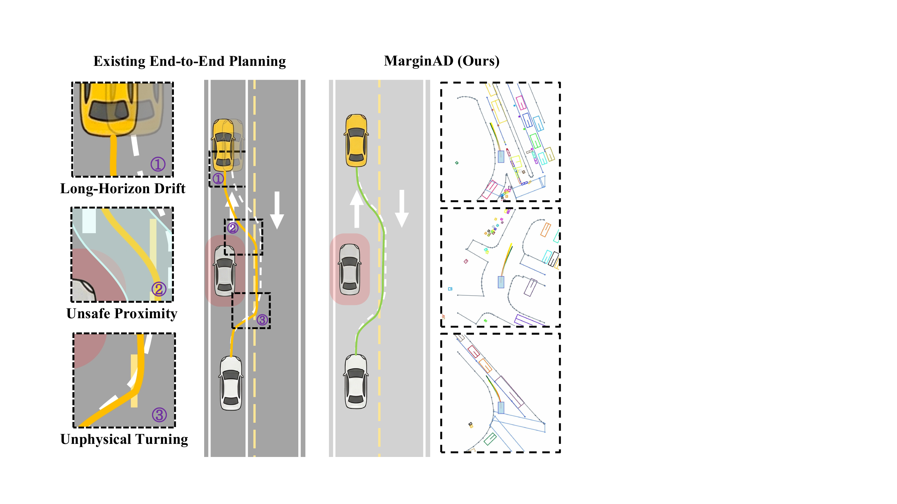
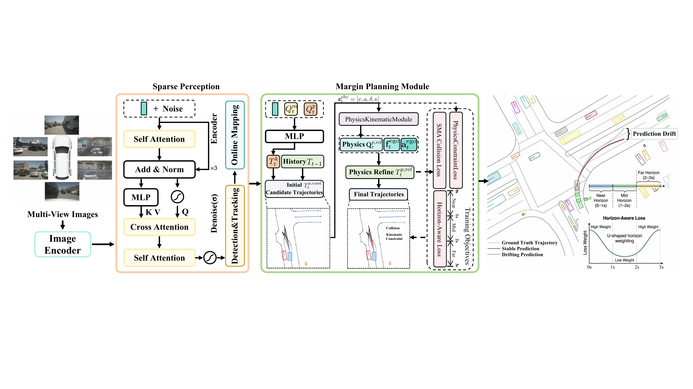

<p align="center">
  
</p>

<h1 align="center">MarginAD</h1>

<p align="center">
  Official implementation of <strong>MarginAD</strong> for the paper:
</p>

<p align="center">
  <strong>Mind the Margin: Safety- and Physical-Aware Planning for End-to-End Autonomous Driving</strong><br>
  Qi Xiong, Jinlai Zhang, Chuan Hu, Hao Chen, and Lin Hu<br>
  IEEE Robotics and Automation Letters, accepted in August 2026
</p>

<p align="center">
  
</p>

MarginAD is an end-to-end autonomous driving planning framework built on the MomAD/SparseDrive-style camera-only pipeline. It refines the planning head with:

- physics-aware kinematic guidance for more feasible ego trajectories;
- safety-margin-aware collision loss for safer clearance around surrounding agents;
- horizon-aware regression weighting for more stable long-horizon planning.

On nuScenes, MarginAD improves the MomAD baseline from **0.60 m to 0.55 m** Avg. L2, **0.09% to 0.08%** Avg. collision rate, and **0.54 m to 0.47 m** Avg. TPC. On the more challenging Shift-nuScenes subset, it reduces Avg. L2 from **1.54 m to 0.75 m** and Avg. collision rate from **0.38% to 0.19%**.

## News

- `2026-08`: MarginAD was accepted by IEEE Robotics and Automation Letters.

## TODO

- [ ] Release pretrained checkpoints.
- [ ] Release Shift-nuScenes split tokens and mining script.
- [ ] Add detailed reproduction logs.

## Installation

Create the environment:

```bash
conda create -n MarginAD python=3.8 -y
conda activate MarginAD
```

Install PyTorch and Python dependencies:

```bash
cd /path/to/MarginAD
pip install --upgrade pip
pip install torch==1.13.0+cu116 torchvision==0.14.0+cu116 torchaudio==0.13.0 --extra-index-url https://download.pytorch.org/whl/cu116
pip install -r requirement.txt
```

Install `mmcv-full` with a wheel matching your local CUDA and PyTorch versions. For a CUDA 11.3 / PyTorch 1.11 environment, one tested option is:

```bash
pip install mmcv-full -f https://download.openmmlab.com/mmcv/dist/cu113/torch1.11.0/index.html -i https://pypi.tuna.tsinghua.edu.cn/simple
```

Install `flash-attn` offline if needed. For example, download the matching wheel from the [flash-attention releases](https://github.com/Dao-AILab/flash-attention/releases), then run:

```bash
pip install flash_attn-0.2.2+cu113torch1.11.0-cp38-cp38-linux_x86_64.whl
```

Compile the deformable aggregation CUDA operator:

```bash
cd projects/mmdet3d_plugin/ops
python setup.py develop
cd ../../../
```

## Data Preparation

Download the [nuScenes dataset](https://www.nuscenes.org/nuscenes#download) and CAN bus expansion. The expected layout is:

```text
MarginAD/
  data/
    nuscenes/
      samples/
      sweeps/
      maps/
      v1.0-trainval/
      can_bus/
```

Create the data link:

```bash
mkdir -p data
ln -s /path/to/nuscenes ./data/nuscenes
```

Generate metadata and labels:

```bash
sh scripts/create_data.sh
```

Generate K-means anchors:

```bash
sh scripts/kmeans.sh
```

Download the ResNet-50 backbone weight:

```bash
mkdir -p ckpt
wget https://download.pytorch.org/models/resnet50-19c8e357.pth -O ckpt/resnet50-19c8e357.pth
```

## Training

Stage 1 trains detection and map components:

```bash
bash ./tools/dist_train.sh projects/configs/Margin_Stage1_Full.py 8 --deterministic
```

Stage 2 trains the full detection, map, motion, and planning model:

```bash
bash ./tools/dist_train.sh projects/configs/Margin_Stage2_Full.py 8 --deterministic
```

For quick local debugging, the helper script uses one GPU:

```bash
sh scripts/train.sh
```

Training logs and checkpoints are saved under `work_dirs/` by default.

## Evaluation

Evaluate a trained checkpoint:

```bash
bash ./tools/dist_test.sh \
  projects/configs/Margin_Stage2_Full.py \
  work_dirs/Margin_Stage2_Full/iter_5860.pth \
  8 \
  --deterministic \
  --eval bbox
```

For one-GPU evaluation, update the checkpoint path in `scripts/test.sh` and run:

```bash
sh scripts/test.sh
```

## Visualization

After evaluation, visualize saved planning results:

```bash
sh scripts/visualize.sh
```

By default, this reads `work_dirs/Margin_Stage2_Full/results.pkl` and writes visualizations to `vis_long_Margin_Stage2_Full/`.

## Main Files

- `projects/configs/Margin_Stage1_Full.py`: Stage 1 configuration.
- `projects/configs/Margin_Stage2_Full.py`: full MarginAD configuration.
- `projects/mmdet3d_plugin/models/motion/physics_kinematic_module.py`: physics-aware kinematic feature module.
- `projects/mmdet3d_plugin/models/motion/motion_planning_head_roboAD.py`: motion and planning head with MarginAD losses.
- `tools/data_converter/`: nuScenes metadata conversion.
- `tools/kmeans/`: anchor generation scripts.
- `tools/visualization/`: visualization utilities.

## Acknowledgement

This codebase builds on the OpenMMLab ecosystem and follows the camera-only end-to-end planning pipeline used by SparseDrive and MomAD. We thank the authors of these projects for their open-source contributions.
